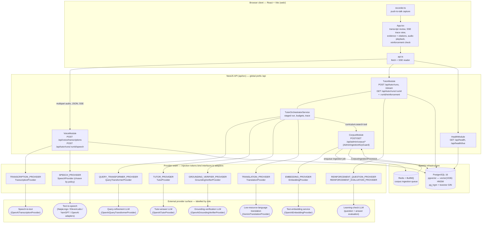

# STEM AI Tutor

A curriculum-grounded, multi-agent voice STEM tutor proof of concept.


## Completed proof-of-concept layers

The current milestone provides:

- A NestJS API.
- PostgreSQL 16 with pgvector 0.8 and `pg_trgm` fuzzy matching.
- Liveness and database-readiness endpoints.
- Unit tests for the health checks.
- Redis-backed BullMQ document ingestion.
- Protected PDF upload and ingestion-status endpoints.
- PDF extraction, deterministic chunking, OpenAI embeddings, and hybrid search.
- A typed, in-process multi-agent tutoring harness with centralized policies.
- A structured model-backed query-transformer stage before retrieval.
- Deterministic retrieval plus separate model-backed tutor and grounding-verifier agents.
- Persisted tutor runs, ordered traces, tool invocations, budgets, and safe errors.
- Synchronous text-only tutor-run creation and retrieval endpoints.
- A responsive React/Vite browser workspace with push-to-talk and typed fallback for this prototype.
- Server-side OpenAI transcription, ElevenLabs tutor voice, and explicitly
  selectable YarnGPT/OpenAI speech adapters.
- Explicit transcript review before the existing grounded tutor can run.
- A bounded post-answer learning check with grounded questions, typed or
  recorded responses, semantic answer evaluation, praise, and non-revealing hints.
- A persisted server-sent event trace, visible retrieval evidence, citations,
  refusal states, browser audio controls, and per-stage metrics.
- Ten locked curriculum evaluation fixtures with mock/live JSON, CSV, manifest,
  Markdown, and separate manual-review exports.
- Captioned deterministic screenshots, a local fallback recording, and a live
  ten-fixture evaluation result.

 [Link to voice output demo](https://github.com/user-attachments/assets/1ae42eaf-2810-48eb-8c15-c10058659039)

## Architecture

A React/Vite browser client handles capture and presentation only. All reasoning,
grounding, and persistence run server-side in a NestJS API under the global `/api`
prefix, composed of four feature modules. State lives in PostgreSQL 16 with pgvector
and `pg_trgm`; Redis/BullMQ keeps PDF ingestion off the request path. Every external
dependency is reached through a provider seam — a NestJS injection token binding a
narrow interface to a vendor adapter — so providers are swapped by re-binding one token.



### Further diagrams

All diagrams are derived from the source and cite their derived-from paths in comments.

| Diagram | File | What it shows |
| --- | --- | --- |
| System architecture | [`docs/diagrams/architecture.md`](docs/diagrams/architecture.md) | The figure above, with its full thesis caption. |
| Component structure | [`docs/diagrams/component-diagram.puml`](docs/diagrams/component-diagram.puml) | UML components: controllers, orchestrator, `TutorAgent`/`TutorTool` contracts, tool registry, harness policy, retrieval, ingestion, persistence. |
| Grounded run sequence | [`docs/diagrams/pipeline-sequence.puml`](docs/diagrams/pipeline-sequence.puml) | UML sequence of one end-to-end run: ASR → transcript confirmation → query transformer → hybrid retrieval → tutor → verifier → bounded revision → translation → TTS. |
| Run state machine | [`docs/diagrams/run-state-machine.md`](docs/diagrams/run-state-machine.md) | Run lifecycle states, the three decision points, the four refusal paths, and the completed/failed terminals. |
| Database schema | [`docs/diagrams/er-diagram.md`](docs/diagrams/er-diagram.md) | All eleven tables from the migrations, with the `vector(1536)` column, constraints, and foreign keys. |

The two `.puml` files render with any PlantUML tool, for example:

```bash
plantuml docs/diagrams/component-diagram.puml docs/diagrams/pipeline-sequence.puml
```

## Prerequisites

- Node.js 22 (Node.js 20 is also supported for local development).
- npm 10 or later.
- Docker with Compose support.

## Setup

```bash
cp .env.example .env
npm install
npm run db:up
npm run migration:run
npm run start:dev
```

The API listens on `http://localhost:3000` and the browser app on
`http://localhost:5173` by default. The development server proxies `/api` to the
API. Set `WEB_ORIGINS` explicitly for every browser origin outside the local
default.

`OPENAI_API_KEY`, `NAIJALINGO_API_KEY`, `ELEVEN_LABS_API_KEY`, and
`YARN_GPT_API_KEY` remain server-side.
`VITE_API_ORIGIN` is optional and must contain only the public API origin; never
place a secret in a `VITE_` variable, browser code, logs, traces, evaluation
output, screenshots, or documentation.

9jaLingo is the default tutor speech provider:

```dotenv
TTS_PROVIDER=naijalingo
NAIJALINGO_API_KEY=
NAIJALINGO_API_URL=https://api.9jalingo.org
NAIJALINGO_VOICE_PCM=ada_pcm
NAIJALINGO_VOICE_IG=adaeze_ig
NAIJALINGO_VOICE_YO=adeola_yo
NAIJALINGO_VOICE_HA=aisha_ha
TTS_CHUNK_PREFERRED_CHARACTERS=550
TTS_CHUNK_MAX_CHARACTERS=700
TTS_APPLICATION_TIMEOUT_MS=300000
```

OpenAI remains the ASR provider. `elevenlabs`, `yarngpt`, and `openai` remain
explicit `TTS_PROVIDER` alternatives. Provider failures never trigger
automatic fallback.

## Verify the application

Check that the API process is alive:

```bash
curl http://localhost:3000/api/health/live
```

Expected response:

```json
{"status":"ok"}
```

Check that the API can connect to PostgreSQL, pgvector, `pg_trgm`, and Redis:

```bash
curl http://localhost:3000/api/health
```

Expected response shape:

```json
{
  "status": "ok",
  "database": {
    "status": "connected",
    "name": "stem_tutor",
    "postgresVersion": "16.x",
    "vectorVersion": "0.8.0",
    "trigramVersion": "1.6"
  },
  "queue": {
    "status": "connected",
    "provider": "bullmq",
    "datastore": "redis"
  }
}
```

## Upload a curriculum PDF

Set real values for `ADMIN_INGESTION_KEY` and `OPENAI_API_KEY` in `.env`, then
restart the API. Uploads are limited to text-based PDFs of 20 MB or less.

```bash
curl -X POST http://localhost:3000/api/admin/corpus/documents \
  -H "x-admin-ingestion-key: YOUR_ADMIN_KEY" \
  -F "file=@/path/to/basic-science.pdf" \
  -F "subject=Basic Science" \
  -F "schoolLevel=SS1" \
  -F "curriculum=NERDC" \
  -F "sourceTitle=Basic Science Text" \
  -F "licence=CC BY 4.0" \
  -F "topicLabel=Physical and Chemical Changes"
```

The endpoint returns `202 Accepted` with `documentId` and `ingestionId`. Monitor
the asynchronous job with:

```bash
curl \
  -H "x-admin-ingestion-key: YOUR_ADMIN_KEY" \
  http://localhost:3000/api/admin/corpus/ingestions/INGESTION_ID
```

The same workflow is available from the CLI:

```bash
npm run ingest -- \
  --file /path/to/basic-science.pdf \
  --subject "Basic Science" \
  --school-level SS1 \
  --curriculum NERDC \
  --source-title "Basic Science Text" \
  --licence "CC BY 4.0" \
  --topic-label "Physical and Chemical Changes"
```

Corpus retrieval combines embedding cosine similarity, PostgreSQL full-text
matching, and typo-tolerant trigram word similarity. The administrative search
returns the ranked top-k candidates before threshold enforcement. Inspect each
result's `semanticSimilarity`, `lexicalSimilarity`, `hybridScore`, and `accepted`
fields, plus the response's `topCandidate` and `acceptedCount` diagnostics.

## Run the text-only tutor harness

The interactive harness runs synchronously in the API process. A query-transformer
agent first turns conversational wording into a concise, intent-aware curriculum
search query. The retrieval agent then calls `CorpusSearchService` through the
internal `curriculum.search` tool; it does not call the protected administration
endpoint. A model-backed tutor receives only accepted chunks, then an independent
model-backed verifier checks material claims and citations. A live request
requires `OPENAI_API_KEY`, all three configured text models, and the populated
corpus and embedding configuration from Milestone 2.

The tutor uses a warm, patient STEM-mentor persona. It briefly acknowledges
context the student actually shared, such as meeting a topic in class or finding
it difficult, before easing into the explanation. It never invents personal
details, and friendly framing does not relax evidence or citation rules.

```bash
curl -X POST http://localhost:3000/api/tutor/runs \
  -H 'content-type: application/json' \
  -d '{"question":"What is a physical change?","language":"en"}'
```

The response contains the original question, safe structured query transformation,
final model-generated answer or refusal, retrieved chunks, citations, grounding
decision, aggregate metrics, tool invocations, ordered trace events, and structured
safe errors. Retrieve the persisted result later with:

```bash
curl http://localhost:3000/api/tutor/runs/RUN_ID
```

The harness never emits a normal answer without evidence whose hybrid score is
at or above `TUTOR_RETRIEVAL_THRESHOLD`. Rejected top-k candidates remain visible
in the `curriculum.search` tool trace for diagnosis. Citation IDs are restricted
to accepted chunks, verifier failure permits only one controlled revision, and
time, call, token, cost, and retry limits are configured in `.env.example`.
The default `TUTOR_MAX_TOKENS=32000` covers the bounded draft, verifier,
single-revision, and final-verifier path. Deployments with an older explicit
value should update it and restart the API.

Tutor and verifier models are independently replaceable through `TUTOR_MODEL`
and `GROUNDING_VERIFIER_MODEL`. Their bounded output tokens and per-million-token
cost estimates are configured separately. The committed defaults use
`gpt-5.6-terra`; the query transformer remains independently configured as
`gpt-5.6-luna`. All model calls use strict JSON-schema output and `store: false`.
Automated tests replace provider clients and make no paid external calls.

## Run the browser voice tutor

Start PostgreSQL, Redis, the API, and the Vite client:

```bash
npm run db:up
npm run migration:run
npm run start:dev
```

Open `http://localhost:5173`. The English proof-of-concept flow is deliberately
explicit:

1. Press **Start push-to-talk**, grant microphone access, and stop within the
   configured recording limit; or type a question.
2. Review and edit the transcript.
3. Check the confirmation box and run the tutor.
4. Inspect persisted stage events, retrieved curriculum chunks, source locators,
   citations, and the grounding or refusal decision.
5. For a completed grounded answer, use the browser audio controls to play the
   clearly disclosed ElevenLabs AI-generated tutor voice.
6. Answer the short learning-check questions by voice or text. Correct answers
   receive encouragement; incorrect answers receive a hint and another attempt.

The browser never calls OpenAI, ElevenLabs, or YarnGPT directly and never
supplies arbitrary text to the speech route. `POST /api/voice/transcriptions`
accepts a bounded
multipart audio upload for OpenAI ASR. `POST /api/tutor/runs/stream` streams
trace checkpoints that are written to PostgreSQL before presentation.
`POST /api/tutor/runs/:runId/speech` loads the persisted run and requires
`completed`, `grounding.grounded=true`, non-refusal, and a canonical answer. The
web client safely renders the answer's simple Markdown as headings, paragraphs,
emphasis, and lists. Before TTS, the server deterministically removes those
presentation markers so they are not spoken aloud; no new answer content is
generated. Refused, failed, running, ungrounded, unknown, empty, and overlong
runs never call the selected speech provider.

Reinforcement uses three bounded endpoints:

```text
POST /api/tutor/runs/:runId/reinforcement
GET  /api/tutor/runs/:runId/reinforcement
POST /api/tutor/runs/:runId/reinforcement/answers
```

Question generation is idempotent per run. The model selects application-built
answer-unit IDs instead of copying a free-text rubric, and every unit is an exact
excerpt from the verified answer linked to canonical chunks. Expected answers
are never returned to the browser. Malformed generation receives one bounded
retry, and a hint that could reveal the answer is replaced with safe
application-owned guidance. The evaluator classifies equivalent student
wording, while application code owns praise and hints. Each question has at most
three attempts, preventing an unbounded model loop.

Audio bytes are processed in memory and are not stored by this application.
Only transcripts, submitted learning-check answers, safe model/latency/cost
metadata, tutor runs, evidence, and traces are persisted. ElevenLabs receives
only the cleaned canonical tutor-answer text—not microphone audio, student
questions, transcripts, chunks, prompts, reasoning, citations as metadata,
reinforcement data, account data, or identifying information.


## Corpus licence and reproducibility pins

The local fixture manifest identifies two ingested `Basic Science Text`
documents and their ingestion IDs. Local metadata records `CC BY 4.0`; it does
not record a source URL, named author, or publisher. That attribution gap must
be resolved before public seminar publication. Do not substitute the example
`CC BY 4.0` upload command above for the actual source licence.

Default model pins are listed in `.env.example` and copied into every evaluation
manifest: `gpt-5.6-luna` query transformation, `gpt-5.6-terra` tutor/verifier
and reinforcement, `text-embedding-3-small` embeddings,
`gpt-4o-mini-transcribe-2025-12-15` ASR, and the current 9jaLingo TTS revision
with `9jalingo-tts-1` plus the configured Nigerian Pidgin voice.

## Scope and known limitations

This is an English-only system-level proof of concept. No students were tested;
there is no learning-effectiveness, student-preference, or production-readiness
claim. It excludes accounts, long-term
progress, teacher dashboards, distributed quotas, spoken reinforcement, and
production deployment.


## Quality checks

```bash
npm run lint
npm test
npm run test:integration
npm run build
npm run migration:show
npm run demo -- --mode mock
```

CI runs API/web lint and tests, deterministic 9jaLingo, ElevenLabs, and YarnGPT
adapter tests, PostgreSQL/Redis integration tests, explicit migrations,
production builds, and the mock demo harness without provider keys or paid calls. See
[`docs/ci.md`](docs/ci.md).

## Manual deployment handoff

Deployment is deliberately outside scope of this prototype. The project reproducer must choose hosting, provision PostgreSQL/pgvector and Redis, apply all
explicit migrations with `synchronize: false`, configure server-side secrets and
origins/rate limits, ingest/verify the licensed corpus, , perform the outstanding human/device checks, and deploy manually. No hosting, cloud resources, domain, DNS, or production secret was
created by this work.
