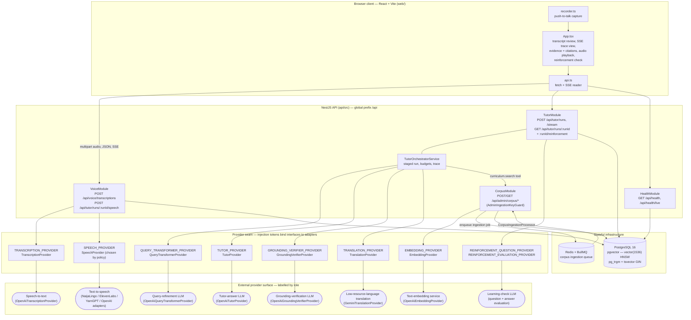

# High-Level System Architecture

<!--
Derived from:
  api/src/main.ts                                  (global 'api' prefix, CORS, exposed TTS headers)
  api/src/app.module.ts                            (TypeORM/Postgres, BullMQ/Redis, feature module list)
  api/src/health/health.module.ts                  (HealthModule)
  api/src/corpus/corpus.module.ts                  (CorpusModule, EMBEDDING_PROVIDER seam, ingestion queue)
  api/src/tutor/tutor.module.ts                    (TutorModule, all provider/agent injection tokens)
  api/src/voice/voice.module.ts                    (VoiceModule, TRANSCRIPTION_PROVIDER / SPEECH_PROVIDER seam)
  api/src/tutor/tutor.constants.ts                 (injection token names)
  api/src/voice/voice.constants.ts                 (injection token names)
  api/src/tutor/translation/translation.contracts.ts (TranslationProvider, output languages)
  api/src/voice/contracts/voice.contracts.ts       (TranscriptionProvider, SpeechProvider)
  api/src/corpus/embeddings/embedding-provider.ts  (EmbeddingProvider)
  api/src/database/migrations/*.ts                 (pgvector, pg_trgm)
  web/src/api.ts, web/src/App.tsx, web/src/recorder.ts (browser client responsibilities)
-->

**Figure caption.** The system is a three-tier, provider-agnostic architecture. A React/Vite browser client
(`web/`) owns only presentation concerns: microphone capture, explicit transcript review before any tutor run
starts, live rendering of the server-sent trace, display of retrieved evidence and citations, audio playback of
the synthesised answer, and the post-answer learning check. All reasoning, grounding, and persistence happen
server-side in a NestJS API exposed under the global `/api` prefix, composed of four feature modules —
`HealthModule`, `CorpusModule` (admin-key-guarded ingestion and hybrid search), `TutorModule` (the orchestrated
grounded run and reinforcement endpoints), and `VoiceModule` (transcription and speech synthesis). State lives in
PostgreSQL 16 with the `vector` extension (a 1 536-dimension embedding column indexed by HNSW under cosine
distance) and `pg_trgm` alongside a `tsvector` GIN index for the lexical half of hybrid retrieval; Redis backs a
BullMQ queue that decouples PDF ingestion from the request path. Every external dependency is reached only
through an explicit provider seam: a NestJS injection token (for example `TUTOR_PROVIDER`, `SPEECH_PROVIDER`,
`EMBEDDING_PROVIDER`) binds a narrow TypeScript interface to a concrete vendor adapter, so a vendor can be
swapped by re-binding one token in a module. Note two points where the code diverges from what a reader might
assume: the speech seam is bound by a `useFactory` (`selectSpeechProvider`) that picks one of four adapters from
runtime policy rather than a fixed class, and the reinforcement providers are bound in `TutorModule` rather than
in a separate module.
