# Entity-Relationship Diagram

<!--
Derived from every migration in api/src/database/migrations/ (all eleven tables appear):
  2026072217000-CreateCorpusLibrary.ts    corpus_sources, curriculum_topics, corpus_documents,
                                          ingestion_runs, corpus_chunks (+ vector(1536) HNSW index)
  2026072222000-CreateTutorHarness.ts     tutor_runs, agent_events, tool_invocations
  2026072223000-AddHybridCorpusSearch.ts  pg_trgm extension + FTS/trigram indexes on corpus_chunks
  2026072224000-AddQueryTransformation.ts tutor_runs.query_transformation
  2026072310000-AddVoiceMetrics.ts        voice_sessions + tutor_runs.voice_session_id (UNIQUE, FK)
  2026072412000-AddReinforcementLearning.ts reinforcement_question_sets, reinforcement_attempts
  2026072610000-AddTranslatedTutorOutput.ts tutor_runs.output_language / translated_answer /
                                          translation_metadata
Cross-checked against the TypeORM entities in api/src/corpus/entities/, api/src/tutor/entities/,
api/src/tutor/reinforcement/ and api/src/voice/entities/.
-->

```mermaid
erDiagram
    corpus_sources ||--o{ corpus_documents : "FK source_id (ON DELETE RESTRICT)"
    corpus_documents ||--o{ ingestion_runs : "FK document_id (ON DELETE CASCADE)"
    corpus_documents ||--o{ corpus_chunks : "FK document_id (ON DELETE CASCADE)"
    curriculum_topics ||--o{ corpus_chunks : "FK topic_id (ON DELETE SET NULL)"

    voice_sessions |o--o| tutor_runs : "FK voice_session_id, UNIQUE (ON DELETE SET NULL)"
    tutor_runs ||--o{ agent_events : "FK run_id (ON DELETE CASCADE)"
    tutor_runs ||--o{ tool_invocations : "FK run_id (ON DELETE CASCADE)"
    tutor_runs ||--o| reinforcement_question_sets : "FK run_id, UNIQUE (ON DELETE CASCADE)"
    reinforcement_question_sets ||--o{ reinforcement_attempts : "FK question_set_id (ON DELETE CASCADE)"
    voice_sessions |o--o| reinforcement_attempts : "FK voice_session_id, UNIQUE (ON DELETE SET NULL)"

    corpus_sources {
        uuid id PK "gen_random_uuid()"
        varchar_300 title
        varchar_300 author "nullable"
        varchar_300 publisher "nullable"
        varchar_1000 source_url "nullable"
        varchar_200 licence
        timestamptz created_at
    }

    curriculum_topics {
        uuid id PK
        varchar_150 subject
        varchar_80 school_level
        varchar_100 curriculum
        varchar_80 code "nullable"
        varchar_250 label
        text description "nullable"
        timestamptz created_at
        UNIQUE UQ_curriculum_topic_identity "subject, school_level, curriculum, label"
    }

    corpus_documents {
        uuid id PK
        uuid source_id FK
        varchar_150 subject
        varchar_80 school_level
        varchar_100 curriculum
        varchar_250 default_topic_label "nullable"
        varchar_80 default_topic_code "nullable"
        varchar_300 original_filename
        varchar_100 mime_type
        integer size_bytes
        char_64 sha256 "UNIQUE — dedupes re-uploads"
        varchar_1000 storage_path "nullable, cleared after ingestion"
        varchar_30 status "CHECK queued|processing|ready|failed"
        integer page_count "nullable"
        text error_message "nullable"
        timestamptz created_at
        timestamptz updated_at
    }

    ingestion_runs {
        uuid id PK
        uuid document_id FK
        varchar_100 bullmq_job_id "nullable"
        varchar_30 status "CHECK queued|processing|completed|failed"
        varchar_50 stage "extracting|chunking|embedding|saving|completed|retrying|failed"
        integer progress "CHECK 0..100"
        integer pages_processed
        integer chunks_created
        integer chunks_embedded
        integer embedding_tokens
        integer topics_mapped
        integer unmapped_chunks
        text error_message "nullable"
        timestamptz started_at "nullable"
        timestamptz finished_at "nullable"
        timestamptz created_at
        timestamptz updated_at
    }

    corpus_chunks {
        char_64 id PK "content-addressed, not a uuid"
        uuid document_id FK
        uuid topic_id FK "nullable"
        integer chunk_index
        integer page_start
        integer page_end
        text content
        char_64 content_hash
        integer token_estimate
        varchar_300 source_locator "human-readable citation locator"
        varchar_100 embedding_model
        integer embedding_dimensions
        vector_1536 embedding "pgvector; HNSW vector_cosine_ops"
        timestamptz created_at
        UNIQUE UQ_corpus_chunks_document_index "document_id, chunk_index"
        INDEX IDX_corpus_chunks_content_fts "GIN to_tsvector('english', content)"
        INDEX IDX_corpus_chunks_content_trgm "GIN lower(content) gin_trgm_ops"
    }

    voice_sessions {
        uuid id PK
        varchar_20 language "default 'en'"
        jsonb asr_metrics "nullable — AsrMetrics"
        jsonb tts_metrics "nullable — TtsMetrics"
        timestamptz created_at
        timestamptz updated_at
    }

    tutor_runs {
        uuid id PK
        varchar_30 status "CHECK created|running|completed|refused|failed"
        text question
        varchar_20 language "input language, default 'en'"
        varchar_10 output_language "default 'pcm' — pcm|ig|yo|ha"
        uuid voice_session_id FK "nullable, UNIQUE"
        jsonb query_transformation "nullable — refinedQuery, intent, concepts, corrections"
        jsonb retrieved_chunk_ids
        jsonb retrieved_chunks "accepted evidence snapshot"
        text draft_answer "nullable"
        text final_answer "nullable — English, with citation markers"
        text translated_answer "nullable — student-facing, markers stripped"
        jsonb translation_metadata "nullable — provider, model, tokens, latency"
        jsonb citations "chunkId, sourceTitle, sourceLocator"
        jsonb grounding "nullable — GroundingResult"
        boolean refused "also true when status='failed'"
        text refusal_reason "nullable"
        jsonb metrics "tokens, cost, latency, agentCalls, toolCalls, retries, revisions"
        jsonb errors "StructuredRunError[]"
        timestamptz started_at "nullable"
        timestamptz completed_at "nullable"
        timestamptz created_at
        timestamptz updated_at
    }

    agent_events {
        uuid id PK
        uuid run_id FK
        integer sequence "UNIQUE with run_id — total trace order"
        varchar_80 event_type "run.created, agent.started, tool.completed, run.refused, ..."
        varchar_80 stage
        varchar_30 status "CHECK started|completed|failed|info"
        varchar_100 agent_name "nullable"
        varchar_100 tool_name "nullable"
        jsonb summary
        integer latency_ms "nullable"
        integer token_count
        numeric_12_8 estimated_cost_usd
        integer retry_count
        varchar_80 error_code "nullable"
        text error_message "nullable"
        timestamptz created_at
    }

    tool_invocations {
        uuid id PK
        uuid run_id FK
        varchar_100 agent_name
        varchar_100 tool_name
        varchar_30 status "CHECK running|completed|failed"
        jsonb input_summary
        jsonb result_summary "nullable"
        integer duration_ms "nullable"
        integer token_count
        numeric_12_8 estimated_cost_usd
        integer retry_count
        varchar_80 error_code "nullable"
        text error_message "nullable"
        timestamptz created_at
        timestamptz completed_at "nullable"
    }

    reinforcement_question_sets {
        uuid id PK
        uuid run_id FK "UNIQUE — at most one set per run"
        jsonb items "grounded question items"
        varchar_120 model
        jsonb usage
        timestamptz created_at
    }

    reinforcement_attempts {
        uuid id PK
        uuid question_set_id FK
        uuid question_id "identifies an item inside items"
        integer attempt_number
        text student_answer
        boolean correct
        text feedback
        text hint "nullable — non-revealing"
        varchar_120 model
        jsonb usage
        varchar_300 evaluation_summary
        integer latency_ms
        uuid voice_session_id FK "nullable, UNIQUE"
        timestamptz created_at
        UNIQUE UQ_reinforcement_attempt_number "question_set_id, question_id, attempt_number"
    }
```

**Figure caption.** The full relational schema created by the seven migrations, in four groups. The **corpus
library** (`corpus_sources`, `curriculum_topics`, `corpus_documents`, `ingestion_runs`, `corpus_chunks`) holds
licensed curriculum material and its ingestion audit trail; `corpus_chunks` is the retrieval unit and carries the
`vector(1536)` embedding column indexed with HNSW under `vector_cosine_ops`, plus a `tsvector` GIN index and a
`pg_trgm` trigram index that together supply the lexical half of hybrid search. The **tutor harness**
(`tutor_runs`, `agent_events`, `tool_invocations`) records one row per run alongside its fully ordered trace —
`agent_events.sequence` is unique per run, which is what makes the stored trace replayable in the same order the
student saw it stream — and one row per tool invocation with its own token and cost accounting. **Voice metrics**
live in `voice_sessions`, whose `asr_metrics` and `tts_metrics` JSONB columns capture per-stage model, latency and
cost. **Reinforcement** adds `reinforcement_question_sets` (at most one per run) and `reinforcement_attempts`,
uniquely keyed by question and attempt number so repeated tries are counted rather than overwritten. Several
schema choices deserve comment because they diverge from the conventional reading. `corpus_chunks.id` is a
`char(64)` content hash rather than a generated UUID, making chunk identity — and therefore citation identity —
stable across re-ingestion. Deletion policy is deliberately mixed: sources are protected by `ON DELETE RESTRICT`
while documents cascade to their chunks and runs cascade to their traces, so evidence cannot be orphaned but
telemetry is disposable. Both `tutor_runs.voice_session_id` and `reinforcement_attempts.voice_session_id` are
nullable *and* uniquely constrained, giving a strict zero-or-one pairing between a voice session and whatever
consumed it. Finally, `tutor_runs` stores the English `final_answer` and the student-facing `translated_answer`
in separate columns; only the latter has citation markers stripped, and only it is ever sent to speech synthesis.
