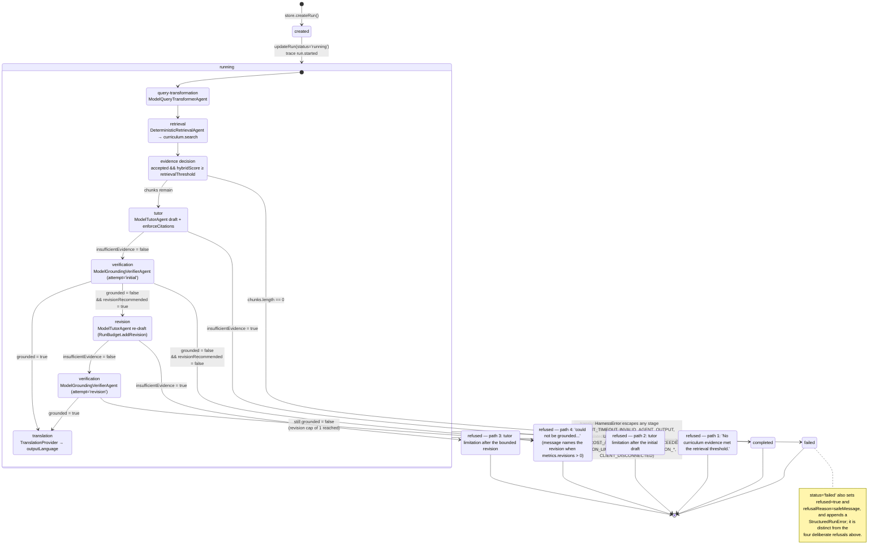

# Tutor Run Lifecycle — State Machine

<!--
Derived from:
  api/src/tutor/contracts/tutor-run-state.ts            (TutorRunStatus: created | running | completed | refused | failed)
  api/src/tutor/services/tutor-orchestrator.service.ts  (stage order, the four refuse() call sites, the catch -> failed path)
  api/src/tutor/policies/harness-policy.service.ts      (RunBudget ceilings; maxRevisions = 1)
  api/src/tutor/policies/harness-error.ts               (HarnessError codes and stages)
  api/src/database/migrations/2026072222000-CreateTutorHarness.ts (CHK_tutor_runs_status enforces the same five values)
-->

**Figure caption.** The run lifecycle as implemented in `TutorOrchestratorService.run()`. The persisted status
column takes only the five values enumerated by `TutorRunStatus` and enforced by the `CHK_tutor_runs_status`
constraint — `created`, `running`, `completed`, `refused`, `failed` — so the stage names shown inside the
`running` composite state are not persisted statuses; they are the `stage` field of the trace events and the
sequence points at which the orchestrator branches. Three decision points govern the flow. The evidence decision
applies after retrieval and keeps only chunks that are both `accepted` and at or above `retrievalThreshold`. The
grounding decision reads the verifier's `grounded` flag. The revision decision is bounded: `RunBudget.maxRevisions`
is fixed at 1 in code rather than being configurable, so at most one re-draft can occur, and the second
verification runs with `revisionAvailable = false`. Four distinct paths terminate in `refused`, corresponding to
the four `refuse()` call sites in the orchestrator: no evidence survives the retrieval threshold; the tutor agent
itself reports `insufficientEvidence` on the initial draft; the tutor reports `insufficientEvidence` again on the
revised draft; and the verifier still reports not-grounded, either immediately (when revision was not recommended)
or after the single permitted revision, in which case the refusal message explicitly names the exhausted revision.
Only the grounded path continues to translation and then to `completed`. A fifth terminal state, `failed`, is
reached when a `HarnessError` escapes any stage — timeouts, malformed structured output, a citation to unretrieved
evidence, an exceeded token/cost/agent-call budget, a translation-provider failure, or client disconnection. One
divergence worth noting for a thesis reader: `failed` also sets `refused = true` in the same row, so a query that
counts refusals by the boolean column will include failures; the two are separable only by the `status` value.
